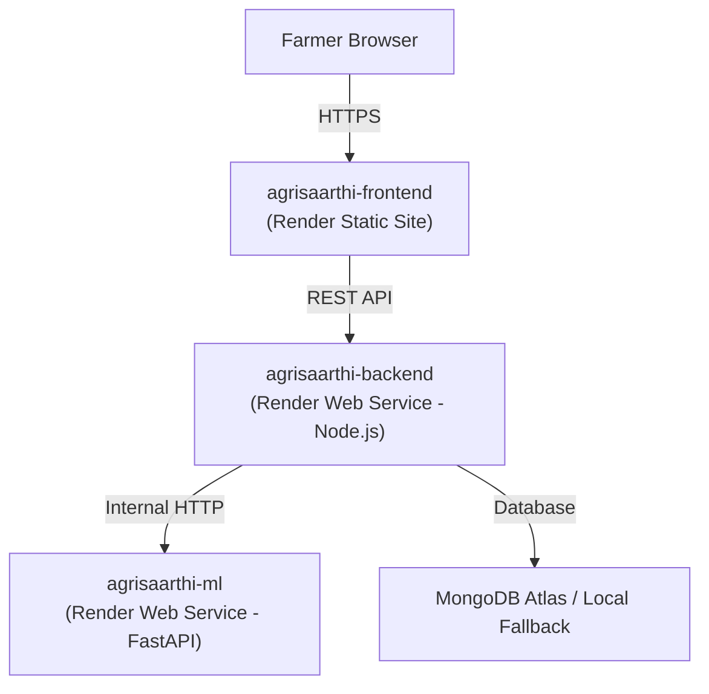

# AgriSaarthi 🌱 — Production Deployment Guide

This project is configured for automated, one-click multi-service deployment on **Render** via Infrastructure-as-Code ([render.yaml](./render.yaml)).

---

## Architecture on Render

When deployed using the blueprint, Render spins up three interconnected services:



1. **`agrisaarthi-frontend`** (Static Site)
   * React 19 + Vite single-page application
   * Rewrite rule: `/* -> /index.html`
   * Environment variable: `VITE_API_URL` dynamically linked to `agrisaarthi-backend`
2. **`agrisaarthi-backend`** (Node.js Web Service)
   * Express 5 API server
   * Health Check: `/api/health`
   * Auto-generated `JWT_SECRET`
   * Automatically wired to `agrisaarthi-ml` and `agrisaarthi-frontend`
3. **`agrisaarthi-ml`** (Python Web Service)
   * FastAPI + Scikit-Learn crop recommendation service
   * Health Check: `/docs`
   * Automatically serves `/recommend`

---

## One-Click Deployment Steps on Render

### Step 1: Push Changes to GitHub
Commit and push the deployment files to your repository:
```bash
git add .
git commit -m "Add Render blueprint and deployment configurations"
git push origin main
```

### Step 2: Create Blueprint on Render
1. Go to [dashboard.render.com](https://dashboard.render.com) and log in.
2. Click **New +** in the top navigation bar and select **Blueprint**.
3. Connect your GitHub repository: `dineshkamble9948-web/AgriSaarthi`.
4. Render will automatically parse [render.yaml](./render.yaml) and display the three services:
   * `agrisaarthi-ml`
   * `agrisaarthi-backend`
   * `agrisaarthi-frontend`

### Step 3: Configure Environment Secrets
Render will prompt you for the un-synced environment variables. Fill in your credentials:
* **`MONGO_URI`**: Your MongoDB connection string (e.g., `mongodb+srv://...`). *(Optional: if omitted, the backend will automatically use its in-memory fallback store)*.
* **`OPENWEATHER_API_KEY`**: Your OpenWeather API key.
* **`PLANTNET_API_KEY`**: Your Pl@ntNet API key.
* **`CDSE_CLIENT_ID`**: Copernicus CDSE Client ID (for Sentinel-2 satellite data).
* **`CDSE_CLIENT_SECRET`**: Copernicus CDSE Client Secret.

### Step 4: Click "Apply"
Render will build and deploy all three services in order:
1. `agrisaarthi-ml` installs Python dependencies and starts Uvicorn.
2. `agrisaarthi-backend` starts Express and connects to ML.
3. `agrisaarthi-frontend` builds Vite assets and serves the static site on a public `*.onrender.com` URL.

---

## Alternative: Self-Hosted Docker Deployment

If you prefer deploying with Docker on a VPS (AWS EC2, DigitalOcean, Hetzner):

```bash
# Build and start all three containers
docker compose up -d --build

# View logs
docker compose logs -f
```
* Frontend will be accessible on `http://<your-server-ip>:3000`
* Backend on `http://<your-server-ip>:5000`
* ML Service on `http://<your-server-ip>:8000`
